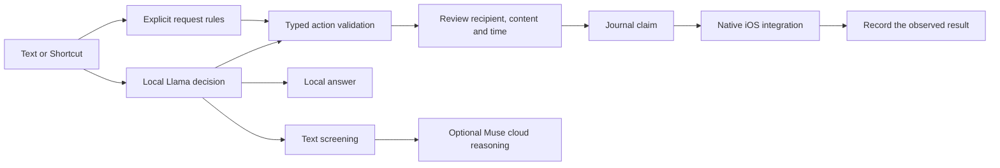

# OffLlama

**Built with Llama** · A local model for useful phone actions.

OffLlama runs a distilled Llama 3.2 1B model on an iPhone. It answers simple
questions offline, makes small structured decisions, and connects supported
requests to native iOS actions. Action contracts, visible drafts and a persistent
journal keep model output separate from permission to act.

I'm Habib, a computer science student at Hunter College. My subway commute often
has no signal. I wanted an assistant that could keep working there, remember
useful facts locally, and show me what it was about to do.

**Prototype status.** A signed build is installed on an iPhone 17 Pro, and the user
verified an answer of **4 to “What is 2 + 2?” with Airplane Mode on and Wi-Fi off**.
Newer action and conversation repairs have passing core tests and Apple build
checkpoints, with final phone acceptance still in progress. See the exact commits
and remaining checks in [project status](docs/PROJECT_STATUS.md) and the
[verification ledger](ORCHESTRATOR_LEDGER.md).

## What it does

- **Local answers and memory.** The same small model generates answers. Facts are
  stored in SQLite on the phone. Recent conversation context is used only for
  local answers; it is not included in cloud requests.
- **Native actions.** Reminders and calendar use EventKit. Messages and Mail use
  native compose sheets after review. A message draft shows its recipient and
  body. A composer result is not treated as proof of delivery.
- **Visible decisions.** The model scores options such as answer, use a tool or
  ask a question. The UI separates the model's top choice, the fallback actually
  used and application rules. Scores describe decisions, not delivery odds.
- **Useful chat tools.** Separate chats, New chat, Clear and Delete, readable
  status labels, and local HTML/SVG charts from supplied labels and values.
  Waiting and unverified actions remain findable when ordinary chat is cleared.
- **Optional Muse reasoning.** An online request can go to a configured Muse
  model after text screening. The app exposes the exact screened request text.
  Settings offers model presets, a Custom option and concealed Keychain-backed
  API-key entry.
- **Voice and Shortcuts.** Apple keyboard Dictation can enter text. The separate
  Muse Voice Transcribe control uploads audio when enabled. App Intents support
  user-configured Shortcuts; no always-listening or locked-phone promise is made.

The [action catalog](docs/SKILLS.md) describes 36 registered skills and their
limits. Some use public app links or user-installed Shortcuts and require a final
step in another app. OffLlama does not tap arbitrary screens, read the entire
Messages inbox, or resolve an existing group chat by its display name.

## How a request reaches an action



Each Reflex decision reads option-letter logits after processing the prompt,
subtracts a content-free prior and compares the resulting top score with the
shipping threshold of **0.90**. An uncertain decision takes its defined fallback.
Explicit message requests and numeric chart requests also have application rules
so a generated chat sentence cannot stand in for a requested action.

The action journal is the execution authority. Recovery shows unfinished or
uncertain work without automatically replaying it. A new bounded multi-step core
has dependency and recovery tests, but its app workflow is not yet connected.
It is not presented as a finished phone feature.

## Measured results

The shipping model was distilled from Muse Glimmer 30B labels. These results use
**120 authored, hand-labeled decisions on Linux**, with 10 examples per original
decision type. They measure individual choices, not complete iPhone tasks.

| Measurement | Before distillation | Shipping model |
| --- | --- | --- |
| Correct option chosen | About 74% | 98 of 120, about 82% |
| Accepted at the comparison threshold of 0.80 | About 15% | 61 of 120, about 51%; 56 accepted choices correct |
| Calibration error, lower is better | 0.150 | 0.064 |

At the **shipping threshold of 0.90**, the model accepted **44 of 120 decisions**,
with **41 of those 44 correct**. The other decisions take a fallback. The model
file is **808 MB (770 MiB)**; file size is not running memory usage.


Sources and definitions are in the [shipping results](eval/results/AFTER_FLOOR.md),
[threshold-specific results](eval/results/PER_TYPE_TAU090.md) and
[evaluation limits](docs/EVALUATION_CLAIMS.md). The earlier statistical certificate
claim was withdrawn because model selection reused the calibration data. No
real-world error guarantee is established. Phone latency, memory and thermal
results remain unmeasured; Linux and GPU timings are not iPhone measurements.

Round-three Glimmer and Spark Open labeling and eight additional candidate models
are experimental. More labels have not yet established a better shipping model.
The repository retains failed experiments and their evaluation results.

## Build and verify

For the core, use Swift 6.1 or a compatible newer toolchain.

```bash
cd core
swift test
```

The iPhone app needs a Mac with full Xcode, an iOS SDK, XcodeGen, Python 3 and Git
LFS. The Xcode project and module keep the original `PocketGlimmer` name; the app
shown on the phone is **OffLlama**, with its existing bundle identity preserved.

```bash
git lfs install
git lfs pull

git clone https://github.com/ggml-org/llama.cpp.git ../llama.cpp
git -C ../llama.cpp checkout ddf48f85c933c1f438212a02eb21e7b001d2d37d

export DEVELOPER_DIR=/Applications/Xcode.app/Contents/Developer
ios/mac_prep.sh framework --llama-src ../llama.cpp
ios/mac_prep.sh prepare --bundle-model --require-model
ios/mac_prep.sh build-unsigned
```

Open `app/PocketGlimmer.xcodeproj`, select your signing team and build for your
phone. The preparation script verifies the pinned framework, shipping GGUF and
calibration. An unsigned build is only a compile and bundle check. Follow the
[Mac runbook](ios/MAC_DAY_RUNBOOK.md) for signing, installation and phone tests.

The recorded Linux checkpoint at `5382349` executes **385 tests, with one opt-in
live test skipped and zero failures**. The independent Apple checkpoint at
`f87567b` passed unsigned and signed Release builds with matching resources.
These are different source checkpoints. [Review evidence](docs/verification/CONVERSATIONS_INDEPENDENT_APPLE_REVIEW_2026-11-04.md)
and [integrated repairs](docs/verification/RELEASE_CANDIDATE_INTEGRATION_2026-11-04.md)
keep that distinction explicit.

## Privacy and boundaries

Keys are stored in the iOS Keychain and are not displayed after saving. Chat
storage verifies protection and backup exclusion before reporting a successful
save. Physical-iPhone protection readback remains an acceptance check.

Cloud text requests may include selected, screened memory snippets. Known names
and common identifiers are masked, but the scrubber can miss information. Audio
is uploaded before transcript screening; image features can send recognizable
pixels. These optional media features are not fully local or anonymized.

Durable admission for requests arriving while busy, voice/camera recovery,
complete multi-step phone flows and broad phone acceptance remain unfinished.
The prototype is not a general autonomous controller for every iPhone app.

## Explore the repository

| Path | Contents |
| --- | --- |
| [`core/`](core/) | Swift decision engine, memory, contracts, action journal and tests |
| [`app/`](app/) | SwiftUI app, native effects, llama.cpp engine and resources |
| [`models/`](models/) | Shipping GGUF and adapters through Git LFS |
| [`training/`](training/) | Teacher labeling, distillation and candidate experiments |
| [`eval/`](eval/) | Evaluation data, scripts, saved measurements and negative results |
| [`docs/demo/OFFLLAMA_THREE_MINUTE_DEMO.md`](docs/demo/OFFLLAMA_THREE_MINUTE_DEMO.md) | Recording flow, narration and rehearsal gates |
| [`docs/SUBMISSION.md`](docs/SUBMISSION.md) | Submission packet being finalized |

The repository was originally named **Pocket Glimmer**. Historical reports retain
that name and their original evidence boundaries. Source code is under the
[MIT license](LICENSE). Model weights and datasets retain their respective
licenses; see [attribution and licensing](docs/LICENSING.md).
