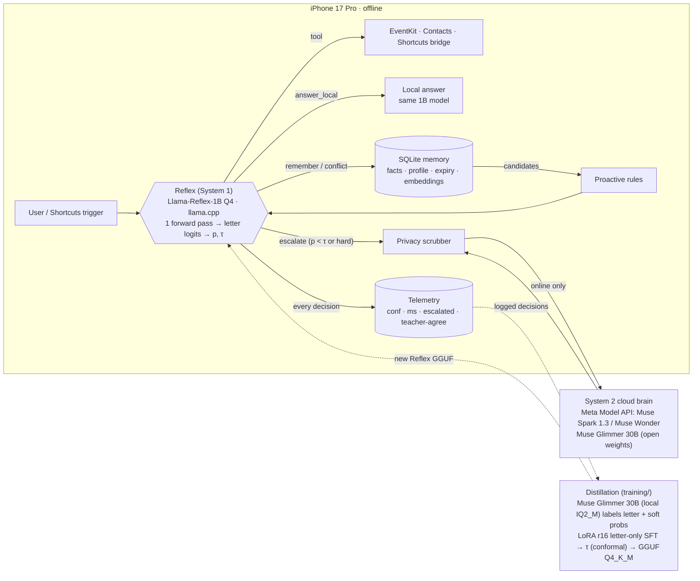
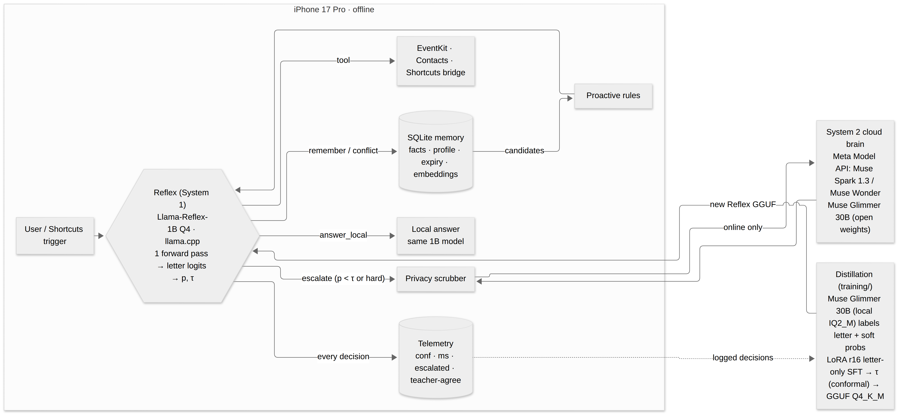
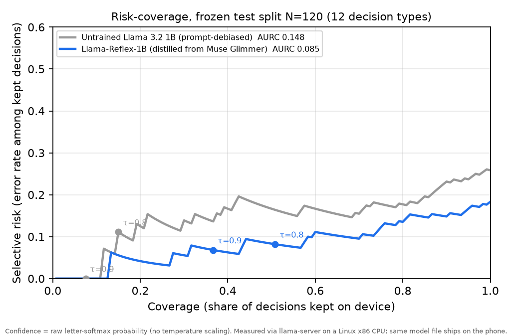

# Pocket Glimmer

**Built with Llama**

**A 1B Meta model on an iPhone that knows when it doesn't know.** Pocket Glimmer is a personal assistant whose
everyday decisions (what to do, which tool, which contact, whether to ask first, whether a request is too private for
the cloud) run on the phone in one forward pass each, with no signal needed. Each decision comes with a confidence.
Above a statistically chosen threshold the phone acts on its own. Below it, the phone asks you, confirms, or hands the
question to Muse Spark 1.3 with personal details masked first.

**Who it's for.** I'm Habib, a CS student at Hunter College, and I live in the Bronx. My commute is underground with no
signal, and the assistants I can use either forget me or keep my life on a server. Pocket Glimmer keeps its memory of
me in SQLite on the phone and keeps working in airplane mode. Theme: **Build for Your World**.

**Four Meta models, four jobs** (details in [Meta stack](#meta-stack-four-meta-models-four-jobs)): Llama 3.2 1B is the
student on the phone; Muse Glimmer 30B, run locally, is its only teacher; Muse Spark 1.3 (Meta Model API, Standard mode)
takes the escalations; Muse Spark Open was tested as a teacher and rejected. Meta distilled Glimmer from Spark's logits,
so the chain is **Spark → Glimmer → Llama-Reflex-1B**.

**The numbers that matter** (frozen held-out test set: 120 hand-labeled decisions, never used for selection; one item = 0.83 pts):

| | Untrained Llama 3.2 1B | **Llama-Reflex-1B (shipping)** |
|---|---|---|
| Accuracy | 74% | **82%** (98/120) |
| Decisions kept on the phone at confidence ≥ 0.8 | 15% | **51%** (61/120), 92% correct |
| Calibration error (ECE, 10 bins, raw letter softmax, no temperature scaling) | 0.150 | **0.064** |
| Area under the risk–coverage curve (lower is better) | 0.148 | **0.085** |

**Certified operating point: τ = 0.90.** On the separate 180-item calibration split, the phone keeps 36% of decisions
(64/180) with 0 errors. Learn-Then-Test bounds the error rate among the decisions it keeps at **≤ 10.2%** (δ = 0.1),
**assuming new requests are exchangeable with the calibration set**. That is a statistical bound on our eval
distribution, not a guarantee. On the frozen test set the same τ keeps 37% (44/120) with 41/44 correct.

## Status at submission (Wed Nov 4 2026)
| What | State | Evidence |
|---|---|---|
| Swift core (`core/`, PocketCore + `pg-cli`) | builds; **55 tests pass** on Linux, Swift 6.1, at last count (run `swift test` for the current count) | `core/Tests/` |
| iOS app (`app/`) | unsigned iOS Simulator build compiled on the Mac (Xcode 27.2, source at e0e5b82). Device build + on-phone numbers: see `docs/FINAL_HOURS.md` | `ios/MAC_DAY_RUNBOOK.md` |
| Shipping model | `SHIPPING-ep1-Llama-3.2-1B-PocketGlimmer-Reflex-Q4_K_M.gguf`, 807,694,080 bytes (808 MB / 770 MiB), sha256 `a5c60a88…82c2`, in Git LFS (`models/`) and release `artifacts-2026-11-01` | `models/README.md`, LEDGER §15 |
| Bundled calibration | `app/PocketGlimmer/Resources/Models/calibration.json`: contextual-calibration priors measured on the shipping GGUF, `defaultTau` 0.90 | `app/PocketGlimmer/Resources/Models/README.md` |
| Swift production path on the shipping GGUF | `pg-cli e2e` (18 cases): 16/18 argmax with bundled priors, 10/18 kept at τ=0.9, **10/10 correct on kept**; every miss escalated (box CPU) | `eval/results/E2E_SWIFT_SHIPPING.md` |
| Eval | reproducible from saved rows and scripts; headline re-run on Nov 4 matched within llama-server noise (cal180 bound 10.4% vs 10.2%) | `eval/results/REPRO_NOV4.md` |
| Training pipeline (`training/`) | 7 Python tests pass | `training/tests/` |
| On-iPhone speed / memory | measured on the device only; not claimed until measured | `docs/FINAL_HOURS.md` §A |

## How it works
- **System 1 · Reflex**: **Llama-Reflex-1B** (distilled from Llama 3.2 1B Instruct; Q4_K_M, llama.cpp + Metal) on-device. Each decision is a typed
  multiple-choice question answered in **one forward pass**: we read the logits of the option-letter tokens,
  subtract a content-free prior (contextual calibration, Zhao et al. 2021), take the softmax, and compare the top
  probability to a threshold τ. The confidence is used raw: no temperature scaling. Below τ it takes the safe fallback
  (escalate / ask / confirm / keep both / skip). 12 decision types: route, tool choice, contact pick, event pick,
  remember-or-not, memory conflict, notification triage, confirm-before-act, nudge-now, timing, sensitivity, answerability.
- **Threshold τ**: certified operating point **0.90**, shipped as `defaultTau` in the bundled `calibration.json`.
  The core's built-in default when no calibration file is loaded is 0.8.
- **System 2**: simple answers come from the same on-device model. Hard reasoning goes to **Muse Spark 1.3 (Meta
  Model API, Standard mode)**. A `sensitivity` decision can veto the cloud and keep a request on the phone. Before
  anything leaves, a privacy scrubber masks names (from Contacts and memory), emails, phones, addresses and card
  numbers, and restores them in the answer. The escalation prompt carries the masked request, the masked memory snippets
  retrieved for it, and a short masked profile with health, money and credential facts removed. The app shows the
  exact text that was sent. Memory itself is stored only on the phone.
- **Memory**: on-device SQLite. Fact extraction, user profile, contradiction handling (Reflex decides
  update / keep both / ignore), provenance, expiry, retrieval, user corrections as retrievable rows. Memory drives proactive nudges.
- **Proactive**: iOS Shortcuts automations (time, arrive, email, message, charger) → App Intent → rules
  pick candidate memories → Reflex decides whether to nudge now.
- **Actions**: EventKit reminders + calendar, Contacts, Messages/Mail compose sheets after confirmation. It never taps inside other apps.
- **Real telemetry**: every Reflex decision is logged (time, type, confidence, escalated, latency, later
  agreement with the teacher). The "share handled on device" chart is built only from those rows.
- **Distillation**: the only teacher is **Muse Glimmer 30B**, run locally (IQ2_M), which labels each question with soft
  option-letter probabilities. Low-confidence labels are dropped (1,006 → 892). LoRA r16, 1 epoch, loss only at the
  answer-letter position: KL(teacher ‖ student over the letter tokens) + 0.5 × CE on the hard label.
  A round-2 sweep (1,790 new Muse Spark Open labels, 11 LoRA variants on Modal H100) was run on Nov 4 under the same cal180 gate and **rejected**: the best variant (V4, teacher-confidence-weighted KL+CE) improved the certified bound to 9.6–9.8% @τ0.88 with 0.54 handled, but its ECE (0.059 fresh / 0.066 warm) crossed the 0.06 clause on repeat runs, so ep1 stays shipping. Full table and lessons: eval/results/ROUND2.md.

## Skills: open-world phone actions
Beyond the built-in tools, a skill registry lets the phone pick from open-world actions (deep links, Shortcuts, share
sheet) through a dynamic `skillPick` decision, with the same confidence-vs-τ rule and safe fallback as every other
decision. What is registered, and what each skill can and can't do, is listed in [docs/SKILLS.md](docs/SKILLS.md).

## Architecture





## Repo

| Path | What | Status |
|---|---|---|
| `core/` | Swift Package **PocketCore**: option sets, Reflex, calibration, SQLite memory, proactive engine, cloud brains, scrubber, telemetry, `pg-cli` | builds + 55 tests pass on Linux at last count (Swift 6.1; `swift test` for the current count) |
| `app/` | SwiftUI iOS app + XcodeGen `project.yml` | Simulator build compiled on the Mac (e0e5b82); device build per `docs/FINAL_HOURS.md` §B and `ios/MAC_DAY_RUNBOOK.md` |
| `training/` | distillation pipeline: local Glimmer teacher (`local_teacher/`), PEFT LoRA on CPU/GPU, Unsloth SFT option, GGUF export | 7 tests pass |
| `eval/` | 300-item hand-labeled gold set (`eval/gold/gold_all.jsonl`), split into 180 calibration / 120 frozen test; scorers; System 2 Q&A runner | baseline + shipping model measured; every result file in `eval/results/` |
| `docs/` | `SUBMISSION.md` (packet), `DEMO_SCRIPT.md` (3-min video), `FINAL_HOURS.md` (submission-day runbook), `research/RELATED_WORK.md` | final |

```bash
cd core && swift build && swift test                 # 55 tests at last count
swift run pg-cli e2e --url http://127.0.0.1:8088     # 18 real decisions against llama-server
cd ../training && python3 -m unittest discover -s tests
```

## On-device model: locked to Llama 3.2 1B

The phone runs **Llama 3.2 1B Instruct Q4_K_M**, distilled into Llama-Reflex-1B. The 3B is more accurate, but its measured
peak of 5.03 GB RSS leaves only ~0.47 GB under our ~5.5 GB memory budget before app and runtime overhead, so the 1B wins on headroom.
Gate-1 lineup (Oct 31 model test on the build box, llama.cpp ddf48f8, llama-server -c 4096 -t 8; the raw RESULTS.md stayed on that box, the numbers are reproduced here and in LEDGER §1).
**Every RSS and tok/s figure below was measured on the box's CPU (8 vCPU x86 AVX2), not on an iPhone.**

| Model | Status | Q&A (15) | Grammar tool calls: valid / correct tool (decision) / tool+args (15) | Raw tool calls: valid / tool / tool+args (10) | Peak RSS (box) | Decode tok/s (box) | Prompt tok/s (box) |
|---|---|---|---|---|---|---|---|
| Llama 3.2 1B Instruct Q4_K_M | complete | 5/15 | 15/15 / 11/15 / 7/15 | 6/10 / 4/10 / 2/10 | 1.99 GB | 47.01 | 987.9 |
| Llama 3.2 3B Instruct Q4_K_M | complete | 14/15 | 15/15 / 15/15 / 12/15 | 10/10 / 8/10 / 4/10 | 5.03 GB | 23.84 | 367.4 |
| Llama 3.1 8B Instruct Q4_K_M | complete (finished 19:08 EDT), not shippable on-device | 15/15 | 15/15 / 15/15 / 12/15 | 10/10 / 9/10 / 6/10 | 9.99 GB | 9.78 | 152.3 |
| Llama 3.1 8B Instruct Q2_K | **partial / not shippable on-device**, stopped at 19 of 40 items | 12/15 (partial) | 4/4 / 4/4 / 2/4 (partial, only 4 of 15 ran) | not run (missing) | 6.14 GB (partial run) | 13.14 (partial) | 106.0 (partial) |
| Muse Glimmer 30B IQ2_M [teacher reference] | complete | 11/11 | 15/15 / 14/15 / 14/15 | 10/10 / 9/10 / 9/10 | 9.65 GB | 2.56 | 36.6 |

### Reflex decisions, frozen held-out test split (120 hand-labeled items, 12 types)

| Model | Accuracy | Handled on device (τ=0.8) | Accuracy on handled | ECE |
|---|---|---|---|---|
| Llama 3.2 1B Q4_K_M, untrained + prompt debiasing (box CPU) | 0.74 | 0.15 | 0.89 | 0.150 |
| Llama-Reflex-1B (distilled) | 82% (98/120) | 51% at τ=0.8 (61/120) | 92% (56/61) | 0.064 |
| Llama-Reflex-1B at the certified τ=0.90 (report only) | 82% (98/120) | 37% at τ=0.90 (44/120) | 93% (41/44) | 0.064 |

Both rows use τ=0.8 so the before/after comparison is like for like. Sources: `eval/results/AFTER_FLOOR.md`,
`eval/results/PER_TYPE_SHIPPING.md` (τ=0.8 per type), `eval/results/PER_TYPE_TAU090.md` (τ=0.90 per type).
Selection (epochs, teacher, quant, τ) used only the 180-item calibration split; the test split was scored once.

**Selective prediction, not one lucky threshold.** The risk–coverage curve (Geifman & El-Yaniv 2017) sorts decisions by
confidence and plots the error among the ones kept. The shipping curve sits below the untrained one at essentially
every coverage level: AURC 0.148 → **0.085**; at τ=0.9 it keeps 37% with 6.8% selective risk, at τ=0.8 51% with 8.2%
(`eval/results/RISK_COVERAGE.md`, test N=120, re-analysis of saved rows).



Reliability diagrams: `docs/img/reliability_baseline_test120_v2cc.png` (before), `docs/img/reliability_after_floor_test120_v2cc.png` (after).

**The certified threshold.** Learn-Then-Test (Angelopoulos, Bates et al. 2021) with exact binomial (Clopper–Pearson)
p-values and Bonferroni over a fixed 99-point τ grid (α 0.05, δ 0.1), on the 180-item calibration split: τ = **0.90**
keeps 36% of items (64/180) with 0 errors, which bounds the error rate among on-device decisions at **≤ 10.2%**
(`eval/results/after_floor.conformal.txt`). That bound holds **only under exchangeability**: new requests must look like
the calibration set. It is a statistical bound on our eval distribution, not a guarantee. The 5% target is not certified
(it needs ≥ 135 handled calibration rows with zero errors). Re-run on Nov 4 with a newer llama.cpp: 10.4% at τ=0.90,
63/180, 0 errors (`eval/results/REPRO_NOV4.md`).

**Out-of-scope stress test** (CLINC150 `oos`, 2,000 prompts, no gold labels, box CPU): the shipping model keeps an
out-of-scope request on device with confidence ≥ τ 0.25% of the time at τ=0.90 (5/2000), 7.3% at τ=0.8
(`eval/results/OOS_STRESS.md`). Not a conformal claim; it shows the certified threshold is also the safe one off-distribution.

**iPhone speed and memory:** measured on the device only. How they are taken is in `docs/FINAL_HOURS.md` §B6
(PGPERF log lines + Xcode memory gauge). No phone speed is claimed until it is measured.

**Prior art.** Certified routing thresholds are not new: Uddin & Bauer (ACL 2026 SRW) set one with Clopper–Pearson for
cloud model pairs, and Conformal Cascade (arXiv 2607.25018) and CR² (arXiv 2605.12001) are related. We haven't found
prior art for the whole combination: the distilled student's own letter-logit confidence as the score, an LTT-certified
threshold, the student running offline on a phone and executing the decisions it keeps, and a privacy veto on
escalation. That doesn't mean none exists. Full survey: `docs/research/RELATED_WORK.md`.

### Negative results (all selected against on the calibration split)
| Tried | Result | Source |
|---|---|---|
| 2 epochs instead of 1 | more confident, not more correct: acc on handled 0.96 → 0.90, bound 10.2% → 14.2% | `eval/results/AFTER_FLOOR_EP2.md` |
| nudgeNow relabel retrain (nv2) | bound 10.9%, acc on handled 0.92; nudgeNow unchanged | `eval/results/AFTER_FLOOR_NV2.md` |
| Muse Spark Open (816B) as teacher | its labels matched gold better (178/180), but the student was overconfident: bound 13.7%, acc on handled 0.90 | `eval/results/SPARK_TEACHER.md` |
| Quant ladder f16 / Q8_0 / Q3_K_M / Q2_K | bounds 14.5% / 13.9% / 13.9% / 30.4%; none beats Q4_K_M | `eval/results/QUANT_IDENTITY.md` |
| Option-order permutation averaging | better bound on cal180, but worse ECE; test120 did not confirm; not shipped | `eval/results/PERM_AVG.md` |
| Muse Glimmer 30B on the phone | Q1_0 outputs gibberish; IQ2_M is 9.85 GB, over budget | below |
| Llama 3.2 3B on the phone | 5.03 GB peak RSS (box CPU), ~0.47 GB headroom | below |
| General-capability drift of the LoRA | none found: mean KL 0.0096 nats, 23/23 checkable answers, 0 collapse | `eval/results/DRIFT_CHECK.md` |

## Earlier measurements (real runs, 2026-10-31, Linux x86 CPU, not a phone)

Untrained **Llama-3.2-1B-Instruct-Q4_K_M** via llama-server (2 threads, CPU shared with another job):

| Suite | argmax accuracy | handled at τ=0.8 | accuracy on handled | median ms (HTTP, CPU) |
|---|---|---|---|---|
| `pg-cli e2e` (18 cases) | 9/18 | 3/18 | 3/3 | 501 |
| `eval/gold_decisions` (36) | 0.53 | 0.11 | 0.75 | 550 |
| **After:** `pg-cli e2e` (18 cases), shipping Llama-Reflex-1B, τ=0.9, Nov 4 (box CPU, 6 threads) | 14/18 (16/18 with bundled priors) | 10/18 | 10/10 | 207 |

The "after" row runs the Swift production code path on the shipping GGUF: all four argmax misses sat below τ and were
escalated, so no wrong decision was kept. N=18 is a smoke test, not a headline (`eval/results/E2E_SWIFT_SHIPPING.md`).

That is the "before" picture: the base model is poorly calibrated and biased toward one letter on `route`, so it
mostly (correctly) escalates. Distillation from Muse Glimmer is how coverage goes up. Phone latency will differ
(Metal, KV-prefix reuse); measure on device, don't extrapolate from these numbers.

## Meta stack: four Meta models, four jobs
| Model | Role | License / access |
|---|---|---|
| **Llama 3.2 1B Instruct → Llama-Reflex-1B** (Q4_K_M, 808 MB) | The student. Runs every decision on the phone (System 1), llama.cpp + Metal | Llama 3.2 Community License ("Built with Llama", see docs/LICENSING.md) |
| **Muse Glimmer 30B** (local, IQ2_M) | The only teacher: its option-letter probabilities are the soft labels for 892 decisions; its labels were checked against human gold before training (43/50 on a QC sample). The closed loop (`training/loop/`) also has it grade the phone's escalated decisions (verdicts feed the "teacher-agree" telemetry column); built with a self-test script (`training/loop/selftest.sh`), not yet run on real phone data | Apache-2.0, open weights |
| **Muse Spark 1.3** | Cloud escalation (System 2) when confidence < τ, behind the privacy scrubber. Meta Model API, **Standard mode** (`muse-spark-1.3`, the default in `core/Sources/PocketCore/CloudBrain.swift:73` and Settings), never Contributor mode | Meta Model API terms |
| **Muse Spark Open** (816B-A42B, via Baseten) | Evaluated as a stronger teacher and **rejected** on the calibration split (see Negative results). First run: $11.06 on Baseten | Muse Model License |

Lineage: Meta pre-trained Glimmer on Muse Spark's outputs with logit distillation (Glimmer tech report, arXiv
2610.24628; Meta blog, Aug 10 2026), so the chain is **Spark → Glimmer → Llama-Reflex-1B**.

Two more Meta roles added on Nov 4, both behind the same decision gate:
- **Muse Voice Transcribe 1.0, Muse Spark 1.3 vision and SAM 3.1** (Meta Model API): hold-to-talk goes through the exact same Reflex path as typed text; a camera "glimpse" runs the sensitivity decision + on-device OCR first, strips EXIF/GPS, then asks Spark and lets SAM 3.1 outline what Spark named. Live-verified from Swift. See `docs/META_MULTIMODAL.md`.
- **Muse Glimmer 30B as a self-hosted System 2** (vLLM on a Modal H100, Apache-2.0 weights, scale-to-zero): the escalation path can run on Meta **open weights end to end**; verified through the app's own `CloudBrain` code (`[PERSON_1]` placeholders survive, 46.7 tok/s warm). See `docs/OPEN_WEIGHTS_SYSTEM2.md`. The default demo escalation remains Muse Spark 1.3.
Muse Wonder (`muse-wonder-1.0`) can be typed into Settings as the cloud model id; it isn't used by default.

## Why not run the 30B on the phone
Measured on the Oct 31 build box (gate-1 run, llama.cpp ddf48f8, CPU):
- Muse Glimmer is **dense, 29.6B active params**: every token reads all weights.
- The smallest coherent quant we tested, **IQ2_M, is a 9.85 GB file** (10.69 GB peak RSS, 2.54 tok/s decode on 8 vCPU).
- **Q1_0 (4.85 GB) is broken**: word salad even greedy, on both AVX2 and generic builds; a model trained for 1-bit (Bonsai 1.7B Q1_0) runs fine on the same build, so the loss comes from post-training 1-bit quantization.
- A phone app has roughly 5.5 GB of RAM to work with (our planning figure, not measured), so Glimmer can't fit. It stays the teacher, and the 1B Reflex runs on device.

## Model choice notes
- MobileMoE-L-SFT is not supported by upstream llama.cpp (no converter/graph as of `ddf48f8`), so the phone runs
  Llama 3.2 1B. The training scripts support MobileMoE (transformers + PEFT) for when a llama.cpp port lands.
  MobileMoE is under the FAIR Noncommercial Research License.
- 1-bit Muse Glimmer (Q1_0) produced gibberish in our gate-1 test, so Glimmer is the teacher, not the phone model.
- Embeddings: the default `HashingEmbedder` (char trigrams) works with zero download; it is the default. Only Meta models are in the stack.

## Prior work
Everything here was written during the hackathon window (Oct 26 – Nov 4, 2026); the first commit is Oct 31 and every
commit is dated Oct 31 – Nov 4. None of Habib's existing products or starter templates were reused. The System 2 Q&A
items in `eval/` come from this week's gate-1 model test. Third-party code: llama.cpp (MIT), SQLite (public domain);
training uses PyTorch, Transformers, PEFT and optionally Unsloth. Related research: `docs/research/RELATED_WORK.md`.

## License
MIT (see `LICENSE`). SQLite amalgamation is public domain. Model weights keep their own licenses.

---
<sub>Footnote: the cloud brain also accepts any OpenAI-compatible endpoint with your own key (Settings → Other). Off by default.</sub>
