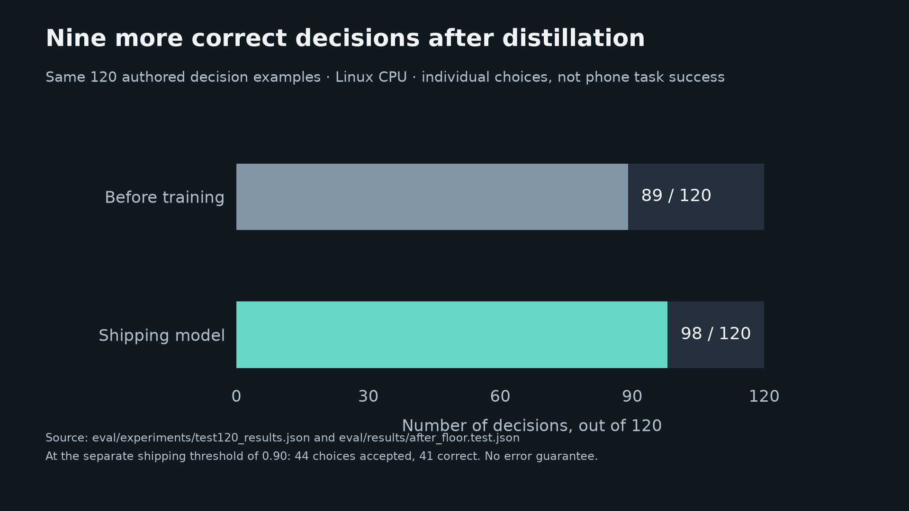
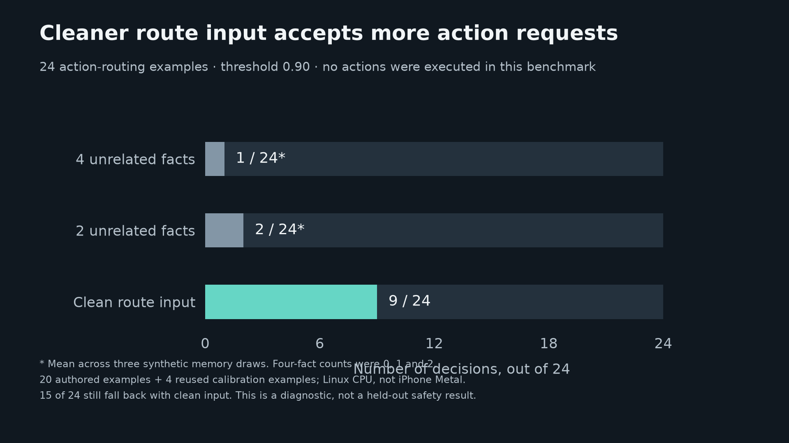

# OffLlama benchmarks, in plain language

These results answer three different questions. A correct model choice, an
accepted choice, and a completed phone action are different outcomes.

## Did distillation improve individual decisions?

Yes, on the saved 120-example Linux decision test. The same authored examples
were used for the untrained and shipping model. There are ten per original
choice type, so this is a small diagnostic of individual decisions.

| Meaning | Before distillation | Shipping model |
| --- | --- | --- |
| Correct option chosen | 89 of 120 (74.2%) | 98 of 120 (81.7%) |
| Accepted at the comparison threshold of 0.80 | 18 of 120 | 61 of 120 |
| Correct among those accepted | 16 of 18 | 56 of 61 |
| Calibration error, lower is better | 0.150 | 0.064 |

Distillation added nine correct choices on this test. At the comparison threshold,
the model accepted more choices, with a similar proportion correct. Calibration
error measures the gap between confidence and observed correctness in score bins.
It is not a task-failure rate or an error guarantee.

The app actually ships a stricter threshold of **0.90**. At that threshold it
accepted **44 of 120 choices**, and **41 of the 44 were correct**. The remaining
76 choices use a fallback. These results do not say that 93% of phone tasks succeed.

Sources: [baseline](../eval/experiments/test120_results.json),
[shipping predictions](../eval/results/after_floor.test.json),
[comparison report](../eval/results/AFTER_FLOOR.md), and
[shipping-threshold breakdown](../eval/results/PER_TYPE_TAU090.md).
The earlier statistical certificate claim was withdrawn because model selection
reused the calibration data. [Evaluation limits](EVALUATION_CLAIMS.md) explains why.

## Did the runtime context repair help routing?

On a separate CPU diagnostic, adding unrelated saved facts lowered confidence.
The repair omits that block from the initial route decision, while preserving
memory for the other choices and local answers.

For the 24 action requests in this diagnostic, the model's tool route cleared the
0.90 threshold on 9 requests with a clean context, 2 with two facts, and an average
of 1 with four facts. The four-fact counts were 0, 1 and 2 across three memory draws.

This is **accepted routing**, not an action executed or delivered. Fifteen of the
24 requests still fell below the threshold with a clean context. Application
rules intercept explicit messages and charts, but broad action-to-chat fallback
remains a limitation. Zero confident errors were observed in this sample; that
cannot establish safety on new requests.

The full experiment has 686 scored decisions over 98 unique decision inputs.
It combines reused calibration rows and newly authored examples, reported
separately in the [full report](verification/LOCAL_MODEL_RELIABILITY_2026-11-04.md).
The calibration rows are not held out. Memory samples are averaged within each
row before uncertainty is calculated; three samples are not three independent
examples. Facts were synthetic and randomly chosen, unlike relevance-ranked
retrieval on a phone. Linux CPU results are not iPhone Metal measurements.

The parent reproduced the saved summary byte-for-byte, checked all 686 scores
were finite, verified complete paired conditions and confirmed no saved score
rounded exactly to the threshold. This validates the saved analysis, not a new
inference run. Scripts, predictions and limitations remain with the report.

## Did more teacher data produce a better shipping model?

Not yet. Eight later candidates were exported. Candidate-only calibration helped
some diagnostic results, but neither the Glimmer candidate C3 nor the Spark
candidate C8 completed and passed the frozen promotion protocol. The runtime
comparison with the shipping incumbent is incomplete. No replacement ships.

The [candidate evaluation](training/R3_PHONE_RUNTIME_EVALUATION.md) reports these
as agreement with teacher labels on developer templates, not human-labelled phone
accuracy. The evaluation source is preserved on
[the research branch](https://github.com/hxbib/pocket-glimmer/tree/t3/phone-runtime-v2-evaluation).
Completed training and labeling work is also preserved on
[the candidate branch](https://github.com/hxbib/pocket-glimmer/tree/research/phone-training-candidates-20261104)
and [the Spark data branch](https://github.com/hxbib/pocket-glimmer/tree/research/spark-phone-labels-20261104).

## What has actually been observed on the phone?

The user observed 2 + 2 = 4 with Airplane Mode on and Wi-Fi off on an earlier
installed build. The reviewed release candidate `7bb9c49` is now signed and
installed with verified resources. Its current manual acceptance record is in
[project status](PROJECT_STATUS.md). Build success does not establish UI behavior.

Phone time to first token, full-request latency, peak memory and thermal behavior
remain unmeasured. The 808 MB model file is storage size, not RAM use. No CPU
or GPU speed number is presented as an iPhone result.

The figure source is [build_release_charts.py](demo/build_release_charts.py).
