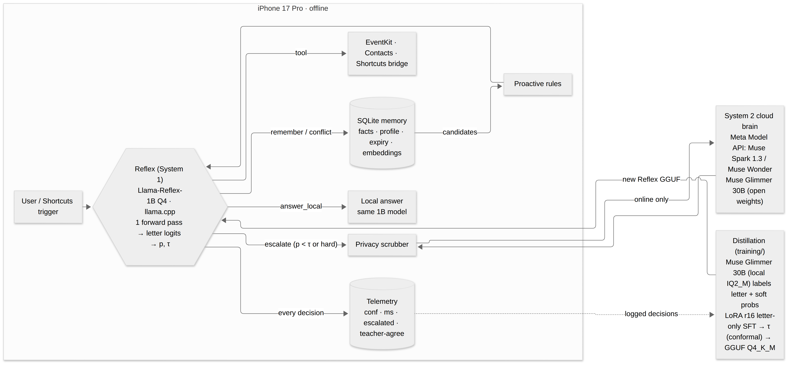
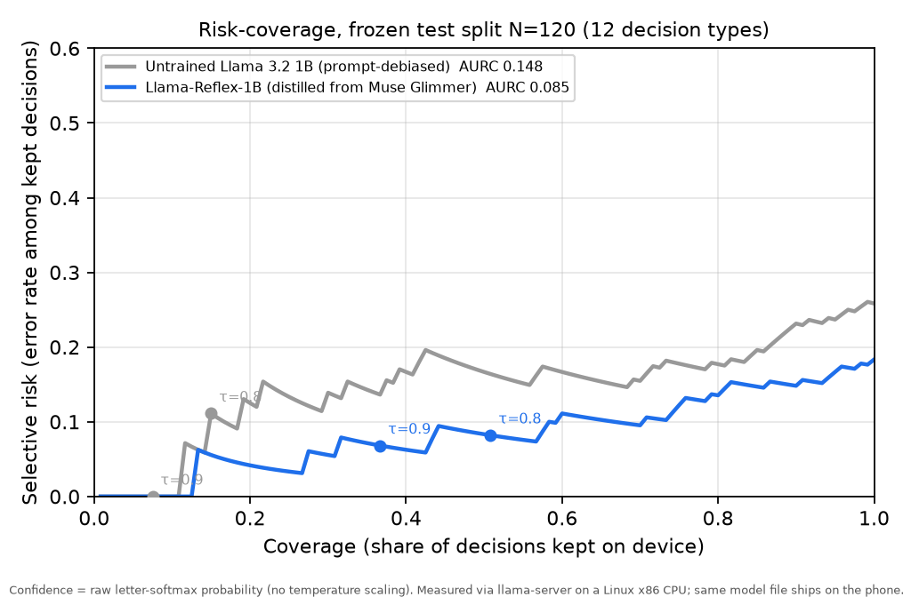

# Pocket Glimmer: submission packet

**Built with Llama** · Indie Developer track · Theme: **Build for Your World** · Solo: Habib (GitHub `hxbib`)

**A 1B Meta model built for iPhone that knows when it doesn't know.** Pocket Glimmer is an assistant that keeps working
with no signal. Llama-Reflex-1B, a Llama 3.2 1B distilled from Muse Glimmer 30B, makes every everyday decision on
the phone in one forward pass. When it isn't sure, it asks me, confirms, or hands the question to Muse Spark 1.3,
with my personal details masked first.

Hook: local memory and confidence-gated decisions. Text escalation masks known names and common identifiers.
Optional voice transcription sends audio to the cloud; photo features send prepared images after a separate privacy check.

Build and demo status: the current iPhone app still needs an Xcode build and device verification. No public demo URL
or completed form submission has been recorded. See [project status](PROJECT_STATUS.md) for the evidence and limits.

## Measured decision results
Report-only split: 120 hand-labeled decisions, 10 per type. No shipping choice used it; 13 reporting runs are saved. One item changes accuracy by 0.83 percentage points. These are Linux CPU decision tests, not phone task-success measurements.

| | Untrained Llama 3.2 1B | **Llama-Reflex-1B (shipping)** |
|---|---|---|
| Accuracy | 74% | **82%** (98/120) |
| Decisions kept on the phone (at τ=0.8, test N=120) | 15% | **51%** (61/120), 92% correct (56/61) |
| Calibration error (ECE, 10 bins, raw letter softmax) | 0.150 | **0.064** |

**Shipping threshold τ = 0.90:** 44/120 report-only decisions accepted, 41/44 correct. The selection split had 64/180 accepted with no errors. Its nominal 10.2% calculation does not account for choosing the model on those same examples and is not a post-selection guarantee. The hand-authored data do not establish a real-traffic guarantee either. [Evaluation correction](EVALUATION_CLAIMS.md).

---

## Impact
**Problem statement fit: Build for Your World.** "Solve a problem you know firsthand."

**The user and the moment.** Me. I'm Habib, a CS student at Hunter College, and I live in the Bronx. Every day I ride
the subway underground with no signal, and that's when I think of things I need to do: text my mom when I'll be home,
set a reminder, check when a meeting is. The assistants I can use either stop working down
there or forget me, and the ones that remember me keep that memory on a server.

**What Pocket Glimmer does in that moment, in airplane mode:** reminders and calendar (EventKit), contacts, messages
(always confirmed first), memory recall and corrections. Each step is a typed decision the phone makes itself. When it
isn't sure, it doesn't guess: it asks ("Which Sam?"), confirms, or waits until it's online and hands the question to
Muse Spark 1.3.

**How much stays on the phone (measured, not projected):**
- At the shipping threshold τ=0.90: 36% of decisions on the calibration split (64/180, 0 errors), 37% on the frozen
  test split (44/120, 41 correct).
- At τ=0.8 on the frozen test split: 51% (61/120), up from 15% for the untrained model.
- Everything else takes a safe path: ask, confirm, keep both memories, skip a nudge, or escalate. Offline, the escalated
  questions get a best-effort local answer that is labeled as such.

**Privacy, concretely.** Memory is SQLite on the phone. For typed requests, cloud reasoning is used on escalation while online.
A `sensitivity` decision can veto the cloud and answer on the phone ("Kept on device · nothing sent"). On escalation,
the request, the memory snippets retrieved for it and a short profile (health, money and credential facts removed) are
masked (names, emails, phones, addresses, card numbers) before they leave, and the app shows the exact text that was sent.

**Who else it's for.** Students and anyone who rides underground, can't pay for cloud AI, or doesn't want their life on
a server.

**What it would take to ship.** The model is an 808 MB file (807,694,080 bytes, 770 MiB). There's no per-user server cost for the
on-device path; the cloud is pay-per-use only when the phone escalates. It builds from source with a free Apple ID (the Simulator build compiled on Nov 2;
device install per the runbook, see Demo). Next: a TestFlight build, a bigger calibration set from real use, and a second distillation round from the
phone's own escalation log (the loop is built: `training/loop/`).

## Use of Meta AI Tooling
The intended runtime models are Meta models. The core model and teacher roles are:

1. **Llama 3.2 1B Instruct → Llama-Reflex-1B (the student, on the phone).** Every Reflex decision, tool call and
   route runs on it, offline, through llama.cpp + Metal. It answers each decision in one forward pass by reading the
   option-letter logits. LoRA r16, merged, Q4_K_M (808 MB). Named "Llama-…" and shipped with "Built with Llama" per
   the Llama 3.2 license.
2. **Muse Glimmer 30B (the teacher, run locally).** IQ2_M on my own machine through llama-server, no API. For each of
   892 decision scenarios it returns probabilities over the answer letters. Those soft labels train the student
   (loss = KL(teacher ‖ student over the letter tokens) + 0.5 × CE). Low-confidence labels were dropped (1,006 → 892).
   Its labels were checked against my hand labels before training (43/50 on a QC sample). The closed loop
   (`training/loop/`) also uses it as the grader of the phone's escalated decisions: its verdicts fill the
   "teacher-agree" column of the phone's telemetry. That part is built with a self-test script, not yet run on real phone data.
3. **Muse Spark 1.3 (cloud escalation).** Meta Model API in **Standard mode** (`muse-spark-1.3`, the default model id in
   `core/Sources/PocketCore/CloudBrain.swift:73` and in Settings; the UI badge reads "Muse Spark 1.3 (Standard mode)").
   Contributor mode is never used. It is never a teacher: the API returns no logprobs, and its terms don't allow it.
4. **Muse Spark Open 816B (an evaluated and rejected teacher).** I relabeled the training set with Spark Open on
   Baseten (k=8 votes, $11.06 for that first run) and retrained. Its labels matched my hand-written gold labels better than Glimmer's
   (178/180 on the calibration split), but the student it taught was **overconfident**: accuracy on handled 0.90 vs
   0.96 and a looser nominal selection-set calculation (13.7% vs 10.2%). A stronger teacher didn't make a better-calibrated student,
   so the Glimmer student ships (`eval/results/SPARK_TEACHER.md`).

**Lineage.** Meta pre-trained Glimmer itself on Muse Spark's outputs with logit distillation (Glimmer tech report,
arXiv 2610.24628). So the chain is **Spark → Glimmer → Llama-Reflex-1B**: we take the same move one step further,
down to a phone.

**What you might not expect.** A 1B Meta model that reports how sure it is, with a stated error rate on the decisions
it keeps, and that uses Meta's cloud only for the questions it can't answer. Glimmer is Meta's "on-device agentic
model", but it targets a 24–32 GB computer. This project puts its everyday judgment on a phone.

| Model | License / access | Role | Why this model |
|---|---|---|---|
| Llama-Reflex-1B (from Llama 3.2 1B Instruct), Q4_K_M | Llama 3.2 Community License, open weights | On-device Reflex: typed decisions, tool calls, routing (llama.cpp + Metal) | 1.99 GB peak RSS on the box CPU (not an iPhone), well under the ~5.5 GB budget; the 3B left only ~0.47 GB |
| Muse Glimmer 30B | Apache-2.0, open weights | Soft-label teacher (local IQ2_M) | Meta's agentic model, too big for the phone (see Technical Depth) |
| Muse Spark 1.3 | Meta Model API, **Standard mode** | Escalation when confidence < τ | Strong reasoning and tool calling |
| Muse Spark Open | Muse Model License, via Baseten | Teacher candidate, rejected on cal180 | A much larger Meta open model (816B-A42B): a fair test of "bigger teacher" |
| Muse Voice Transcribe 1.0 · Muse Spark 1.3 vision · SAM 3.1 | Meta Model API, Standard mode | Voice in → same Reflex path as text; camera glimpse → sensitivity gate → Spark describes, SAM 3.1 outlines | Live-verified from Swift on Nov 4 (`docs/META_MULTIMODAL.md`) |
| Muse Glimmer 30B, self-hosted (vLLM, Modal H100) | Apache-2.0, open weights | Optional System 2 on weights we serve ourselves; same `CloudBrain` code path | Escalation on Meta open weights end to end (`docs/OPEN_WEIGHTS_SYSTEM2.md`) |

## Agentic angle (Best Agentic Use-Case)
Each request is a chain of typed on-device decisions, and every link can stop safely: **route → toolChoice →
contactPick / eventPick → confirmBeforeAct → act** (EventKit, Contacts, Messages/Mail compose). Messages always ask for
confirmation. When contactPick is unsure (two "Sam"s) the phone asks instead of guessing. Hard requests escalate to
Muse Spark 1.3 with personal details masked, and a `sensitivity` decision can keep a request on the phone.
**Proactive:** iOS Shortcuts triggers (time, arrive, email, message, charger) → App Intent → rules pick candidate
memories → a `nudgeNow` decision chooses whether to interrupt. **Memory writes are decisions too:** `rememberOrNot` and
`memoryConflict` (update / keep both / ignore), with provenance and user corrections as retrievable memories.
**Skills:** a skill registry extends the chain to open-world phone actions through a dynamic `skillPick` decision under
the same τ rule (docs/SKILLS.md).

## Demo
- Video (3:00): recording and public upload are pending. The timestamps below are the planned script.
- How to run it: build from source on a Mac with Xcode. `app/project.yml` + XcodeGen, llama.cpp xcframework pinned at
  `ddf48f85c933c1f438212a02eb21e7b001d2d37d` through the provenance-checking wrapper, free Apple ID signing, then copy the shipping GGUF into the app through Finder's Files sharing. Exact steps:
  `ios/MAC_DAY_RUNBOOK.md`. The model is in Git LFS (`models/`) and in release `artifacts-2026-11-01`.
- No phone? The same Swift decision code runs against llama-server: `swift run pg-cli e2e` (18 decisions). On the
  shipping GGUF (box CPU, τ=0.9, bundled priors) it got 16/18 right at argmax, kept 10/18 on device, and all 10 kept
  were correct; every miss escalated (`eval/results/E2E_SWIFT_SHIPPING.md`).
- Canonical timing and voiceover: [demo/STORYBOARD.md](demo/STORYBOARD.md). Rehearsal/evidence notes: [DEMO_SCRIPT.md](DEMO_SCRIPT.md). Keep the submitted timestamps aligned with the actual edited video.

## Technical Depth

- **One forward pass per decision.** Each decision is a multiple-choice question (12 types). The phone reads the logits
  of the option-letter tokens, subtracts a content-free prior (contextual calibration, Zhao et al. 2021), takes the
  softmax, and compares the top probability to τ. Nothing is generated. **No temperature scaling**: the confidence is
  the raw softmax. The priors were measured on the shipping GGUF and ship in the app bundle (`calibration.json`).
- **Safe fallbacks.** Below τ every decision type takes its safe option: escalate, ask, confirm, keep both, skip.
  Messages also always confirm by rule, whatever the confidence.
- **Distillation.** Muse Glimmer 30B (local IQ2_M) → 892 Glimmer-labeled examples → LoRA r16, 1 epoch, loss only at the
  answer letter → merge → Q4_K_M GGUF → llama.cpp Metal. Trained on CPU (bf16, 112 steps, 502 s).
  A round-2 sweep (1,790 new Muse Spark Open labels, 12 H100 candidate variants plus one CPU candidate) was run on Nov 4 under the same cal180 gate and **rejected**: the best variant (V4, teacher-confidence-weighted KL+CE) improved the nominal selection-set calculation to 9.6–9.8% @τ0.88 with 0.54 handled, but its ECE (0.059 fresh / 0.066 warm) crossed the 0.06 clause on repeat runs, so ep1 stays shipping. Full table and lessons: eval/results/ROUND2.md.
- **Threshold: selective prediction with measured fallbacks.** The app ships τ = 0.90 in `calibration.json`. The selection-set count of 0/64 errors gives a nominal 10.2% Clopper–Pearson calculation with δ = 0.1 and a 99-threshold correction; reruns yield about 10.4–10.9%. Model selection reused that set, so it is not a valid post-selection certificate. The 5% target was not certified. [Assumptions and future independent protocol](EVALUATION_CLAIMS.md).
- **Not one lucky threshold.** Risk–coverage on the frozen test split: the shipping curve is below the untrained one at
  essentially every coverage level. AURC 0.148 → **0.085**. At τ=0.9 it keeps 37% with 6.8% selective risk, at τ=0.8
  51% with 8.2% (`eval/results/RISK_COVERAGE.md`).

  

- **Calibration.** ECE 0.150 → **0.064** on the frozen test split, from distillation alone. Charts:
  `docs/img/reliability_baseline_test120_v2cc.png` (before), `docs/img/reliability_after_floor_test120_v2cc.png` (after).
- **Off-distribution.** On 2,000 CLINC150 out-of-scope prompts, the shipping model keeps an out-of-scope request on
  device with confidence ≥ τ only 0.25% of the time at τ=0.90 (5/2000), 7.3% at τ=0.8 (`eval/results/OOS_STRESS.md`;
  no gold labels, so no conformal claim).
- **Protocol.** Headline numbers come only from the frozen test split. Every choice (epochs, teacher, quant, prompt,
  τ) was made on the calibration split. Augmented data never touches either split.
- **Before/after** (both rows: frozen held-out test split, N=120; 300-item gold set = 180 calibration + 120 test):

| Model | Accuracy | Handled on device (τ=0.8) | Accuracy on handled | ECE |
|---|---|---|---|---|
| Llama 3.2 1B Q4_K_M, untrained + prompt debiasing (measured, Linux CPU) | 0.74 | 0.15 | 0.89 | 0.150 |
| Llama-Reflex-1B (distilled) | 82% (98/120) | 51% at τ=0.8 (61/120) | 92% (56/61) | 0.064 |
| Llama-Reflex-1B at the shipping τ=0.90 (report only) | 82% (98/120) | 37% at τ=0.90 (44/120) | 93% (41/44) | 0.064 |

- Per type (`eval/results/PER_TYPE_TAU090.md`): at τ=0.90, contactPick and eventPick stay on device 8/10, route and
  toolChoice 6/10, sensitivity 5/10. nudgeNow is weak (3/10 accurate) and never clears τ, so it always takes its safe
  fallback. confirmBeforeAct is 10/10 accurate but clears τ=0.90 only 2/10.
- **Phone speed:** measured on the iPhone only (Release build, airplane mode, PGPERF log lines). Not claimed until measured.

### Why a 1B on the phone
The 3B is clearly more accurate, but its measured peak (5.03 GB RSS) leaves only ~0.47 GB under the ~5.5 GB budget
before app and runtime overhead. Gate-1 lineup (llama.cpp ddf48f8, llama-server -c 4096 -t 8). **All RSS and tok/s
columns were measured on the box's CPU (8 vCPU x86 AVX2), not on an iPhone:**

| Model | Status | Q&A (15) | Grammar tool calls: valid / correct tool (decision) / tool+args (15) | Raw tool calls: valid / tool / tool+args (10) | Peak RSS (box) | Decode tok/s (box) | Prompt tok/s (box) |
|---|---|---|---|---|---|---|---|
| Llama 3.2 1B Instruct Q4_K_M | complete | 5/15 | 15/15 / 11/15 / 7/15 | 6/10 / 4/10 / 2/10 | 1.99 GB | 47.01 | 987.9 |
| Llama 3.2 3B Instruct Q4_K_M | complete | 14/15 | 15/15 / 15/15 / 12/15 | 10/10 / 8/10 / 4/10 | 5.03 GB | 23.84 | 367.4 |
| Llama 3.1 8B Instruct Q4_K_M | complete (finished 19:08 EDT), not shippable on-device | 15/15 | 15/15 / 15/15 / 12/15 | 10/10 / 9/10 / 6/10 | 9.99 GB | 9.78 | 152.3 |
| Llama 3.1 8B Instruct Q2_K | **partial / not shippable on-device**, stopped at 19 of 40 items | 12/15 (partial) | 4/4 / 4/4 / 2/4 (partial, only 4 of 15 ran) | not run (missing) | 6.14 GB (partial run) | 13.14 (partial) | 106.0 (partial) |
| Muse Glimmer 30B IQ2_M [teacher reference] | complete | 11/11 | 15/15 / 14/15 / 14/15 | 10/10 / 9/10 / 9/10 | 9.65 GB | 2.56 | 36.6 |

Why Llama for the Reflex: three small untrained models on the same 36 gold items (`docs/SYSTEMONE.md`):

| Model (untrained) | Accuracy | ECE | Coverage @ τ=0.8 | Accuracy on covered | Median ms |
|---|---|---|---|---|---|
| Llama 3.2 1B Q4_K_M | 0.53 | 0.10 | 0.11 | 0.75 | 550 |
| Laya Q8_0 | 0.69 | 0.21 | 0.25 | 0.78 | 402 |
| Julia-1 Q8_0 | 0.44 | 0.38 | 0.56 | 0.45 | 84 |

I chose Llama because it's distillable with our LoRA pipeline (Laya is BERT-style). Latency here is the box HTTP round
trip, not the phone.

Why not Glimmer 30B on the phone: it's dense (29.6B). The smallest working file (IQ2_M) is 9.85 GB, over the ~5.5 GB
budget. The 1-bit Q1_0 file gives gibberish. I checked it isn't a llama.cpp bug: a model trained for 1-bit runs fine on
the same build. So I switched to distillation.

### Negative results we're proud of
Each was measured, selected against on the calibration split, and kept in the repo:
- **Glimmer Q1_0 on the phone:** gibberish (post-training 1-bit quantization breaks it). IQ2_M works but is 9.85 GB.
- **Llama 3.2 3B:** more accurate, but ~0.47 GB of headroom. Not worth the risk on a phone.
- **2 epochs instead of 1:** more confident, not more correct. Accuracy on handled 0.96 → 0.90, bound 10.2% → 14.2%
  (`eval/results/AFTER_FLOOR_EP2.md`).
- **nudgeNow relabel retrain (nv2):** bound 10.9%, nudgeNow unchanged (`eval/results/AFTER_FLOOR_NV2.md`).
- **Muse Spark Open teacher:** better labels, worse student. Bound 13.7% (`eval/results/SPARK_TEACHER.md`).
- **Quant ladder:** f16 14.5%, Q8_0 13.9%, Q3_K_M 13.9%, Q2_K 30.4%. All lose to the shipping Q4_K_M on the nominal selection-set
  bound (`eval/results/QUANT_IDENTITY.md`).
- **Option-order permutation averaging:** better bound on cal180 but worse ECE, and the one test120 report didn't
  confirm it. Not shipped (`eval/results/PERM_AVG.md`).
- **Drift check (a negative we wanted):** the LoRA didn't damage general ability. Mean KL 0.0096 nats, 23/23
  checkable answers, 0 collapse into routing text, also on the shipping Q4_K_M (`eval/results/DRIFT_CHECK.md`).

## What I built during the event vs what I used
Everything was written during the event. Commit history (`https://github.com/hxbib/pocket-glimmer/commits/master`):
- **Oct 31 (27 commits):** Swift PocketCore (option sets, Reflex, calibration, conformal LTT, SQLite memory with
  provenance, scrubber, telemetry) and its tests; `pg-cli`; the SwiftUI iOS app (decision cards, confidence bars,
  escalation badge, privacy sheet, telemetry chart); the 300-item hand-labeled gold set with labeling rules; the local
  Glimmer teacher; the untrained baseline.
- **Nov 1 (26 commits):** iOS compile-readiness and Mac runbook; on-device model locked to 1B; the distillation run
  (892 labels, LoRA, Q4_K_M) and its eval; the ep2 and nv2 experiments; the sensitivity "Kept on device" badge; Git LFS
  models and the release.
- **Nov 2 (21 commits, most of them hourly status notes):** drift check; quant identity + quant ladder; removal of temperature-scaling claims; the
  Option A/B threshold proposal; Mac Simulator build passing.
- **Nov 3 (1 commit):** handoff notes and the CLINC stress set.
- **Nov 4:** risk–coverage analysis, Swift e2e on the shipping GGUF, bundled calibration priors, reproduction, OOS
  stress test, permutation averaging, the closed-loop distillation scripts, related work, and these docs.

No earlier products or templates were reused. Used: llama.cpp (MIT), SQLite (public domain), PyTorch, Transformers,
PEFT, Unsloth (optional GPU path), matplotlib. Model weights keep their own licenses.

## Privacy & data handling
- On the phone by default. Memory is SQLite on the device.
- Text reasoning can escalate to Muse Spark 1.3 in Standard mode or the optional self-hosted Glimmer endpoint. Optional voice transcription and image features make separate cloud requests.
- A `sensitivity` decision can keep a request on the phone even when the cloud is available.
- For text escalation, known names (from Contacts and memory), emails, phones, addresses and card numbers are masked, and
  restored in the answer. What leaves is the masked request plus masked relevant memory and a short masked profile with
  health, money and credential facts removed. The app shows the exact text that was sent.
- Voice audio is uploaded before transcript screening. Photos are prepared locally and checked, but recognizable image pixels are not anonymized. The photo gate and text scrubber can miss sensitive information.
- Keys live in the iOS Keychain. Without configured credentials, built-in cloud inference is unavailable; app links and Shortcuts can still hand data to external services.
- The demo uses my own data or made-up data.

## Limitations & assumptions
- The former 10.2% certificate claim is withdrawn. The 180 calibration rows also selected the model, and the statistical correction covered thresholds only. The report-only count is 3 errors in 44 accepted decisions, not a task-success guarantee.
- The 300 examples were written by one person and stratified by type. They do not establish independent sampling from real phone traffic. The 135-zero-error-row calculation applies only under a fixed model, independent sampling and the specified 99-threshold procedure. See [evaluation limits](EVALUATION_CLAIMS.md).
- The untrained baseline and every memory (RSS) and speed figure in the lineup come from the box's Linux x86 CPU, not an iPhone.
- Tool arguments are filled by on-device heuristics and memory, not grammar-constrained decoding.
- The scrubber is regex- and contact-based and will miss some identifiers.
- **Prior art:** certified routing thresholds are not new. Uddin & Bauer (ACL 2026 SRW) set one with Clopper–Pearson
  for cloud model pairs, and Conformal Cascade (arXiv 2607.25018) and CR² (arXiv 2605.12001) are related. We haven't
  found prior art for the whole combination: the distilled student's own letter-logit confidence as the score, an
  confidence threshold, the student running offline on a phone and executing the decisions it keeps, and a privacy
  veto on escalation. That is not the same as saying none exists. Survey: `docs/research/RELATED_WORK.md`.
- Nothing here guarantees a result; the numbers are what we measured on our eval sets.
- The 5–8 tok/s phone figure for 30B in my early notes was an estimate from memory bandwidth. Nothing ran on a phone.

## Team + what's next
- Team: Habib (solo), Hunter College CS student. GitHub: hxbib.
- Bonus prizes flagged: Best Agentic Use-Case; Community Vote.
- Next 30 days: TestFlight, a bigger calibration set from real use, a second distillation round from the phone's own
  escalation log (`training/loop/`), and on-device evaluation.

## Links
- Repo: https://github.com/hxbib/pocket-glimmer
- Video: public upload pending. Add the verified link here and in the CV form after recording.
- Model: `models/SHIPPING-ep1-Llama-3.2-1B-PocketGlimmer-Reflex-Q4_K_M.gguf` (Git LFS) and release `artifacts-2026-11-01`.

---
*Final read by Habib before submit.*
